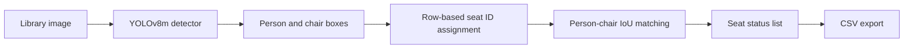

# SeatSnap — Library Seat Occupancy Detection with YOLOv8

**A computer-vision prototype for identifying occupied and available library seats from images.** Developed for ED3010 Human Factors in Design at IIT Madras.

SeatSnap uses a fine-tuned YOLOv8 object detector and spatial matching rules to infer seat occupancy, assign readable seat IDs, and export a per-seat CSV. It targets a practical problem: helping library users identify available places to study without walking through every floor.

> **Project stage:** Research/course prototype evaluated on static library images. It is **not** a deployed real-time seat tracking system, nor a validated production service.

## Features implemented in the supplied source

- YOLOv8m training configuration for four categories: **person, chair, table, partition**.
- Row-wise chair ordering to generate sequential seat IDs from bounding-box centroids.
- Person–chair intersection-over-union (IoU) matching to label chairs as occupied or free (`IoU > 0.05`).
- Append-only seat-level CSV export containing `image_name`, `seat_id`, and `occupied`.
- Interactive command-line choice between training and image inference.

### System overview



## Project files

| File | Purpose |
| --- | --- |
| [`seat_occupancy.py`](seat_occupancy.py) | Supplied training, detection, seat-ID assignment, and occupancy logic |
| [`library.yaml`](library.yaml) | YOLO dataset class configuration |
| [`tests/test_seat_occupancy.py`](tests/test_seat_occupancy.py) | Dependency-free tests of geometric and CSV logic |
| [`.github/workflows/tests.yml`](.github/workflows/tests.yml) | Automated lightweight tests on pushes and pull requests |

## Set up

**Requirements:** Python 3.10+, an image dataset organized for Ultralytics YOLO, and optionally a previously trained model checkpoint.

```bash
python -m venv .venv
# Activate the virtual environment for your operating system
python -m pip install -r requirements.txt
```

The supplied [`library.yaml`](library.yaml) points to `./images/train` and `./images/val`. These **image and label directories are not included**. Supply a permitted dataset with YOLO-compatible labels before training, and verify the paths on your machine. Real library images should not be distributed without appropriate permissions.

### Train a model

```bash
python seat_occupancy.py
# Enter: 1
```

The uploaded code sets `imgsz=1280`, `epochs=80`, `batch=4`, optimizer `AdamW`, and patience `20`. The accompanying course report documents a 120-epoch configuration; the repository preserves the actual **80-epoch code** and does not claim to contain the trained checkpoint.

### Run inference

```bash
python seat_occupancy.py
# Enter: 2
# Enter the path to a permitted library image
```

The inference function expects an already trained checkpoint at:

```
runs/library_train/seat_model/weights/best.pt
```

It writes/updates `seat_level_occupancy.csv` and saves `output.jpg`. **In the current source, `output.jpg` is an unannotated copy of the input image**, despite the printed “annotated output” message. The CSV is the dependable structured output of this script.

### CSV example

```csv
image_name,seat_id,occupied
sample_library.jpg,1,yes
sample_library.jpg,2,no
```

The example illustrates the output schema; it is not an empirical result from the dataset.

## Test the geometry and CSV logic

```bash
python -m unittest discover -s tests -v
```

These unit tests deliberately do not download a YOLO model, open real images, or require GPU hardware. They check bounding-box IoU, row-order seat numbering, person-to-chair matching, and CSV output.

## Evaluation and limitations

The team report describes data collection of **50 library images**, with some manual annotations and qualitative tests under realistic conditions. It notes failures under occlusion, overlapping chairs, and non-top-down camera viewpoints. **Precision, recall, and confusion matrices were not reported**, so this repository does not claim a numerical detection accuracy.

This is a **static-image prototype**, not a video pipeline. The following remain future work or design concepts rather than verified completed implementations:

- Continuous video streaming and live occupancy dashboards
- Stable seat-to-floor-plan calibration across frames
- Privacy-preserving edge hardware, anonymization, and retention policies
- A fully integrated student-facing app (UI concepts exist in the course report)
- Larger dataset evaluation and quantitative benchmarking

**Privacy note:** The public repository intentionally excludes real library photographs, student-labelled records and model weights pending permission checks.

## Team and attribution

SeatSnap was developed as a team project for **ED3010 — Human Factors in Design, IIT Madras** by **Aadhira Vikram, Harini Shakti, and Vishu Kumar**. The accompanying final course report documents the wider design process and UI concepts. The code in this repository is derived from the provided team project materials; individual contributions should be credited accurately.

## Next improvements

A small permission-cleared evaluation dataset, calibrated fixed seat IDs, actual annotated outputs, and quantitative mAP/precision/recall and occupancy error metrics would make this a stronger research and deployment candidate.
